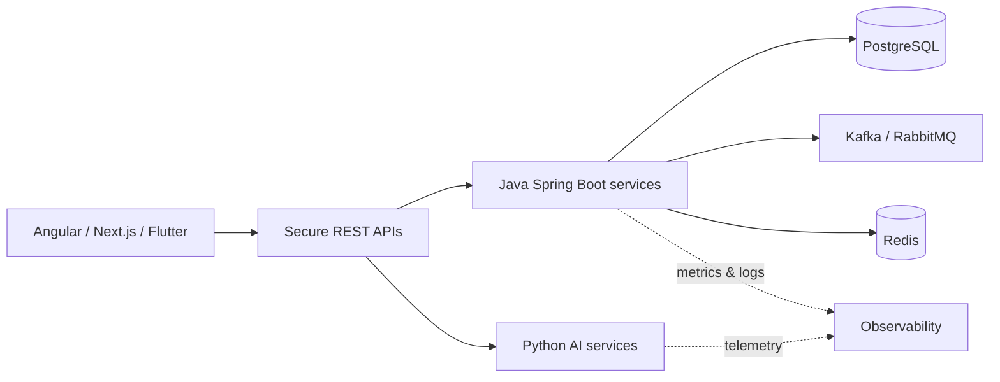

<!--
  Haithem Mihoubi — animated GitHub profile
  Place this README in the haithemmihoubi/haithemmihoubi repository.
  Keep assets/haithem-hero.gif alongside it. No JavaScript, workflows or tracking required.
-->

<div align="center">


### I turn complex systems into reliable software — and ambitious ideas into real products.

**Senior Software Engineer @ TAV Technologies** &nbsp;·&nbsp; **5+ years in software engineering** &nbsp;·&nbsp; **Tunisia 🇹🇳**

<sub>Java / Spring Boot &nbsp;·&nbsp; Distributed systems &nbsp;·&nbsp; Cloud & Kubernetes &nbsp;·&nbsp; Applied AI &nbsp;·&nbsp; Full-stack products</sub>

<p>
  <a href="https://www.linkedin.com/in/haithem-mihoubi/"></a>
  <a href="mailto:haithem.mihoubi.pro@gmail.com"></a>
  <a href="https://github.com/haithemmihoubi?tab=repositories"></a>
</p>

</div>

---

## 👋 About me

I'm **Haithem Mihoubi**, a software engineer who enjoys the work behind dependable products: designing service boundaries, securing APIs, untangling data flows, improving performance, automating delivery and making complicated workflows simple for the people using them.

My experience spans **aviation technology, banking, transportation and SaaS**. I work primarily with **Java 21, Spring Boot 3, Angular, PostgreSQL, event-driven architectures and Kubernetes**, and I also build AI-assisted platforms with Python and modern web technologies.

What matters most to me isn't the number of frameworks in a stack. It's whether the system is **understandable, observable, secure, maintainable and useful**.

## 🧩 Selected products I've worked on

<table>
  <tr>
    <td width="50%" valign="top">
      <h3>🎯 <a href="https://talnivo.pro/">Talnivo</a></h3>
      <b>Founder · Career technology</b><br/><br/>
      A platform for jobs, final-year internships (PFE) and scholarships, with AI-assisted CV analysis, offer matching, application tracking and interview preparation.<br/><br/>
      <code>Career SaaS</code> <code>AI-assisted matching</code> <code>Document workflows</code><br/><br/>
      <a href="https://talnivo.pro/">Explore the product ↗</a>
    </td>
    <td width="50%" valign="top">
      <h3>📄 BidShine</h3>
      <b>Lead Software Engineer · Tender intelligence</b><br/><br/>
      AI-assisted tender analysis and bid preparation, with evidence-backed requirements, document processing, collaborative workflows and bid structure generation.<br/><br/>
      <code>Spring Boot</code> <code>FastAPI</code> <code>PostgreSQL / pgvector</code><br/><br/>
      <i>Private product — proprietary source not publicly available.</i>
    </td>
  </tr>
  <tr>
    <td width="50%" valign="top">
      <h3>🏫 <a href="https://schoolflow.pro/">SchoolFlow</a></h3>
      <b>Full-stack Engineer · Education SaaS</b><br/><br/>
      School operations, attendance, timetables, payments and parent communication, including hardware attendance integration and real-time notifications.<br/><br/>
      <code>Java / Spring Boot</code> <code>Next.js</code> <code>Flutter</code><br/><br/>
      <a href="https://schoolflow.pro/">Explore the product ↗</a>
    </td>
    <td width="50%" valign="top">
      <h3>✨ <a href="https://eyaura.tn/">EyAura</a></h3>
      <b>Full-stack Engineer · AI commerce</b><br/><br/>
      Fashion e-commerce featuring AI virtual try-on, product variants, catalog administration, cash-on-delivery ordering and conversion-focused UX.<br/><br/>
      <code>Next.js</code> <code>NestJS</code> <code>Applied AI</code><br/><br/>
      <a href="https://eyaura.tn/">Explore the product ↗</a>
    </td>
  </tr>
  <tr>
    <td width="50%" valign="top">
      <h3>📚 <a href="https://mammimind.tn/">Mammimind</a></h3>
      <b>Full-stack Engineer · EdTech</b><br/><br/>
      Learning platform for students, with courses, video learning, exercises, subscription workflows and web/mobile experiences.<br/><br/>
      <code>Next.js</code> <code>Flutter</code> <code>NestJS</code><br/><br/>
      <a href="https://mammimind.tn/">Explore the product ↗</a>
    </td>
    <td width="50%" valign="top">
      <h3>🌐 CoursesUniverse</h3>
      <b>Founder · Learning & career development</b><br/><br/>
      A learning and career-development platform with structured IT courses, hands-on labs, quizzes and recruitment-oriented features.<br/><br/>
      <code>Next.js</code> <code>PostgreSQL</code> <code>Docker</code><br/><br/>
      <i>Project overview; no public source repository linked here.</i>
    </td>
  </tr>
</table>

> **About the project links:** live product links are demonstrations, not promises that private commercial source code is open-source. For source code and experiments, see [my public repositories](https://github.com/haithemmihoubi?tab=repositories).

## ⚙️ What I build with

| Area | Technologies |
| :--- | :--- |
| **Backend & APIs** | `Java 21` · `Spring Boot 3` · `Spring Security` · `Python / FastAPI` · `REST` · `OpenAPI` |
| **Frontend & mobile** | `Angular` · `TypeScript` · `React / Next.js` · `Flutter` |
| **Distributed systems** | `Microservices` · `Kafka` · `RabbitMQ` · `Redis` · `DDD` · `CQRS` |
| **Data** | `PostgreSQL` · `JPA / Hibernate` · `MySQL` · `MongoDB` · `pgvector` |
| **Cloud & DevOps** | `Kubernetes` · `Docker` · `Helm` · `Terraform` · `Ansible` · `AWS` · `Azure` · `CI/CD` |
| **Reliability & quality** | `Prometheus` · `Grafana` · `ELK` · `JUnit` · `Testcontainers` · `SonarQube` |

<details>
<summary><b>🗺️ A representative architecture pattern I enjoy working with</b></summary>

<br/>



<sub>This is an illustrative engineering pattern, not a diagram of a specific employer or customer deployment.</sub>

</details>

## 🧠 Experience that shaped my engineering

| Domain | Work |
| :--- | :--- |
| ✈️ **Aviation — TAV Technologies** | Senior engineering work on enterprise software for airport operations and service integration. |
| 🏦 **Banking modernization — PASS Consulting Group** | Java/Spring Boot, Angular, secure APIs and migration from legacy banking systems. |
| 🚕 **Transportation — Logawin** | Microservices, real-time systems, payments, geolocation, caching, CI/CD and production monitoring. |
| 🏛️ **Banking platforms — Value Digital Services** | API integrations, Kafka-based workflows, PostgreSQL, Angular and role-based access control. |

### Engineering impact I care about

- **Performance:** improved API response times by approximately **70%** on an accounting SaaS engagement through query tuning and caching, as documented in my résumé.
- **Delivery:** designed and operated software across enterprise backends, frontend apps, mobile apps and Kubernetes environments.
- **Knowledge sharing:** delivered DevOps and Scrum training for students, engineers and institutional teams.

## 📐 My engineering principles

```text
01  Make business rules explicit.
02  Prefer simple, testable service boundaries.
03  Treat security, observability and failure recovery as features.
04  Measure performance before optimizing.
05  Make AI outputs reviewable and grounded in evidence.
06  Ship the smallest useful thing — then improve it.
```

## 🎓 Learning, teaching & credentials

- **Education:** Master's in Software Engineering & Enterprise Architecture (ISI); Master's in Advanced Robotics & AI (ENSIT); Executive MBA (Academy Europe).
- **Certifications & learning:** Microsoft AZ-900, Microsoft SC-900, AWS and Kubernetes learning credentials, networking and cybersecurity training.
- **Community:** I share practical content about software engineering, DevOps, cloud architecture, AI and career opportunities on [LinkedIn](https://www.linkedin.com/in/haithem-mihoubi/).

---

<div align="center">

### Let's build software that lasts.

If you're working on **Java backend systems, cloud-native platforms, applied AI or ambitious SaaS products**, I'd be glad to connect.

<a href="https://www.linkedin.com/in/haithem-mihoubi/"><b>LinkedIn</b></a> &nbsp;•&nbsp; <a href="mailto:haithem.mihoubi.pro@gmail.com"><b>Email</b></a> &nbsp;•&nbsp; <a href="https://github.com/haithemmihoubi?tab=repositories"><b>Code & experiments</b></a>

<sub>Build thoughtfully · Engineer reliably · Keep learning</sub>

</div>
